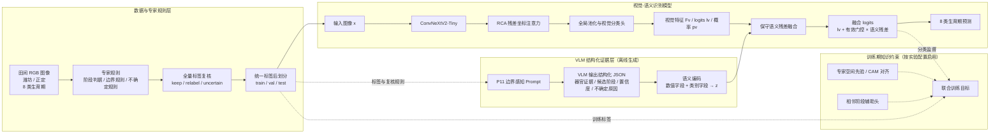

# 小麦生育期识别架构图整理

> 参照 `FieldBCQ-main.zip` 的项目说明组织方式整理；研究对象、模块和流程均为本项目 Wheat-KGCA，不是 FieldBCQ 农田地块分割。

## 1. 方法概述

本项目面向田间 RGB 图像的 8 类小麦生育期识别。整体路线由四层组成：

1. 全量图像按统一农学规则进行标签复核，再形成统一标签和 train/val/test 划分。
2. 边界感知 VLM 按固定提示词生成穗部、花药、旗叶、分蘖、籽粒、颜色和不确定性等结构化证据。
3. ConvNeXtV2-Tiny + RCA 提取视觉表征；语义向量经编码后通过保守门控残差调制视觉分类 logits。
4. 训练阶段使用分类及门控稳定性等损失，并可按对应实验配置加入 CAM/相邻阶段监督；推理输出统一的 8 类预测。

VLM 是结构化证据生成器，不应画成最终分类器。CAM 和相邻阶段辅助监督属于训练期约束，不是额外推理模型。

## 2. 总体架构图

配套可编辑矢量图：[`小麦生育期识别架构图_当前版.svg`](./小麦生育期识别架构图_当前版.svg)。



## 3. 模块说明

### A. 数据与专家规则

输入为潍坊、正定采集的田间小麦图像。中期材料记录全量 24,847 张、8 个生育期。先以统一农学标准复核标签，复核动作使用 `keep / relabel / uncertain`，完成后再形成正式数据划分。重点规则包含旗叶、穗尖/穗部、花药可见性，以及灌浆期与成熟期的主体器官判定。

图中“24,847 张”来自现有答辩路线图；若全量复核和重划分尚未完成，文字应写为“拟复核/重划分”，不要表达成已完成实验结果。

### B. VLM 结构化语义证据

使用边界感知提示词 P11 对图像生成结构化 JSON。证据字段覆盖穗部状态、花药可见性、籽粒饱满度、旗叶孕穗线索、分蘖/拔节线索、植株颜色、图像质量及不确定性。数值字段保留连续值，类别字段编码为 one-hot/数值向量，得到语义向量 `z`。语义生成与视觉模型训练通过样本 ID 对齐；VLM 不替代最终分类器。

### C. 视觉主干与 RCA

视觉分支使用 ConvNeXtV2-Tiny。RCA（Residual Coordinate Attention）在高层特征图上沿高、宽方向编码位置信息，并以残差缩放方式回注：`F' = F + γ(A(F) - F)`。随后全局平均池化得到视觉表征，线性分类头输出视觉 logits。模型配置默认为 8 类任务；具体类别数由训练数据配置决定。

### D. 保守语义残差融合

语义向量经 MLP 编码为语义 token；FiLM 对视觉 token 做轻量调制。模型根据视觉置信度、Top-1/Top-2 间隔和熵估计是否允许语义介入，再由门控和残差头生成类别增量：

```text
fused_logits = visual_logits + effective_gate × delta_logits
```

门控初始化偏保守，并对视觉高置信样本设置保护约束；语义主要用于低置信或易混淆样本的修正。该实现是特征调制加门控残差，不应在图中称为已实现的 CAM-guided Cross-Attention。

### E. 训练约束与输出

主任务输出一个 8 类分类结果。融合训练代码包含融合分类损失、视觉辅助分类、门控约束、视觉预测锚定/边距保护和残差幅度约束。CAM 区域对齐、相邻阶段辅助头属于其他独立实验阶段/配置，只有在答辩介绍对应实验时才纳入训练目标框，不能默认说所有损失同时用于当前最终模型。

推理阶段使用图像和已生成/对齐的结构化语义证据，经视觉分支和门控融合得到一个类别及置信度。训练损失、标签复核和 CAM 对齐不属于推理路径。

## 4. 与 FieldBCQ 项目结构的对应组织方式

| 参考项目文档的组织项 | 本项目对应内容 |
|---|---|
| Dataset / data config | `data/`、复核清单、正式 train/val/test manifest |
| Model definition | `src/models/convnextv2_tiny_res_coordinate.py`、`src/models/convnextv2_attention_variants.py` |
| Custom head / method | `src/fusion/train_semantic_visual_module_v2.py` 中 `ConservativeSemanticVisualModule` |
| Training entry points | `src/train/`、`src/fusion/` 和 `src/paper_full_experiments/` 下对应训练脚本 |
| Evaluation and analysis | `src/summarize_visual_model_runs.py`、`src/summarize_vlm_prompt_comparison.py`、`src/paper_full_experiments/` |
| Results and checkpoints | `outputs/` 下视觉、VLM、融合实验结果 |
| User-facing architecture | 本目录的 SVG 架构图及本说明 |

## 5. 答辩图的层次安排

建议采用从左到右的主流程，并分成四条横向泳道：

- **数据与规则层：** 图像 → 专家规则 → 标签复核 → 数据划分。
- **语义证据层：** P11 → VLM JSON → 语义向量。
- **识别模型层：** 图像 → ConvNeXtV2-Tiny + RCA → 视觉 logits → 门控残差融合 → 八分类结果。
- **训练约束层：** 分类监督为主；CAM 和相邻阶段监督以虚线标注“按实验配置启用”。

这样能沿用参考架构说明的“数据配置、模型主体、创新模块、训练/推理和文件映射”结构，同时保持本项目实际研究内容。

## 6. 答辩口述稿

本研究针对田间小麦图像开展八个生育期识别。首先依据统一农学规则复核全量标签并形成数据划分；随后使用边界感知 VLM 生成器官和生育阶段相关的结构化证据。视觉分支以 ConvNeXtV2-Tiny 为主干，并通过 RCA 增强高层特征的方向位置信息；语义证据经过编码后由保守门控残差调制视觉预测，使模型重点在低置信和易混淆样本上吸收语义信息。训练阶段根据具体实验启用分类、门控稳定性以及 CAM 或相邻阶段辅助监督，最终由统一模型输出八类生育期预测。

## 7. 图示准确性边界

- 这是小麦生育期图像分类，不是农田地块实例分割。
- 最终任务是单张图像的八分类，不是检测多个目标。
- VLM 输出结构化证据，不直接作为最终分类结果。
- 代码中的保守融合是 FiLM 调制与门控 logits 残差；不要标成未经代码证实的 Cross-Attention。
- CAM、相邻阶段辅助头及全量复核完成状态要按所讲的实验版本区分。
